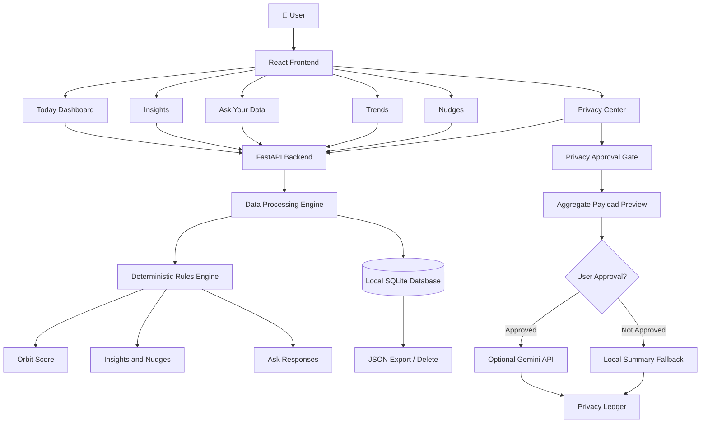
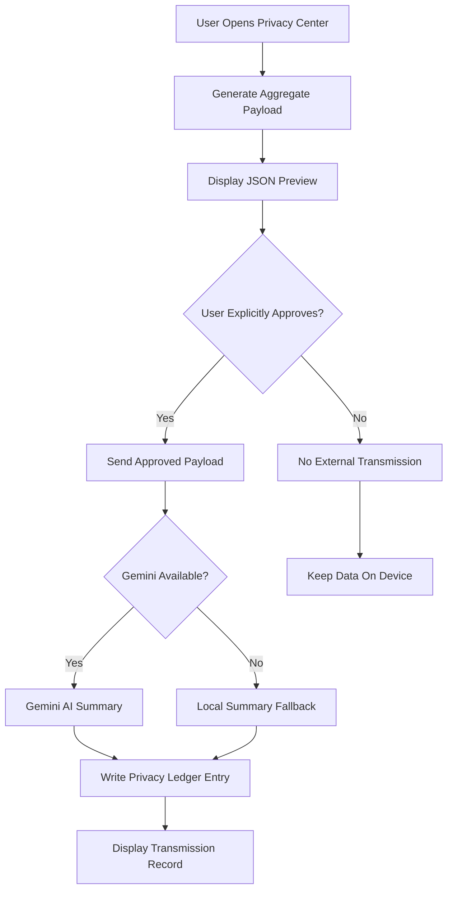
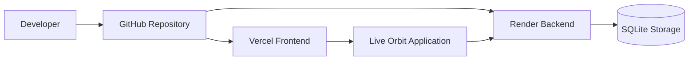

# 🪐 Orbit — Know Your Body.

### Privacy you can see. Insights you can trust.

**A privacy-first personal health intelligence platform that transforms scattered health data into meaningful, explainable insights while keeping users in control of their personal information.**

<p align="center">
  
  
  
  
  
  
</p>

---

demo mvp link - https://orbit-one-ashy.vercel.app/

## 🌌 Overview

Modern smartphones, smartwatches, and fitness trackers collect enormous amounts of personal health data. However, this information is scattered across different applications, making it difficult for individuals to understand their health patterns.

Most applications display numbers without explaining what they mean, while cloud-based AI solutions often require users to share sensitive personal information.

**Orbit solves this problem.**

Orbit is a privacy-first personal health intelligence application that brings together:

- 👟 Daily steps
- 🌙 Sleep duration
- ❤️ Resting heart rate
- 😊 Mood tracking
- 💧 Water intake

It transforms these metrics into a unified health timeline, computes an explainable Orbit Score, identifies cross-metric patterns, generates actionable nudges, and allows users to interact with their own data through natural language.

Its defining feature is **Privacy You Can See**: users can preview the exact aggregate information before approving an optional AI request.

> **Orbit doesn't just tell you what your body is doing. It helps you understand why, what you can try next, and what happens to your data.**

---

## ✨ Key Features

### 1. 🪐 Orbit Score — Your Health at a Glance

A unified score ranging from 0–100 that combines five health and lifestyle indicators.

- Steps
- Sleep
- Resting heart rate
- Mood
- Consistency

The central Orbit visualization displays five interactive biomarker orbs, with their sizes adapting to goal progress.

### 2. 📊 Interactive Health Dashboard

A visually rich dashboard featuring:

- Animated metric cards.
- Daily goal completion indicators.
- Weekly performance comparisons.
- Interactive sparklines.
- Seven-day steps visualization.
- Seven-day sleep duration chart.
- Responsive light and dark themes.

### 3. 🧠 Explainable Insights

Orbit identifies relationships between different health metrics using deterministic rules.

Example:

**Short sleep and next-day activity**

Orbit can identify whether days following shorter sleep periods are associated with lower step counts.

Every insight includes a **"Why am I seeing this?"** explanation with the underlying numbers and mathematical rule.

### 4. 💬 Ask Your Data

A conversational interface that allows users to ask questions about their own health information.

Example questions:

- Why am I feeling tired?
- How many steps did I take?
- What is my average sleep duration?
- How is my resting heart rate changing?
- Am I meeting my daily goals?

Answers are generated using locally available data, with supporting evidence and suggested follow-up questions.

### 5. 🔔 Actionable Nudges

Orbit generates proactive, personalized suggestions based on recorded health patterns.

Examples:

- Take a short walk to reach your step goal.
- Try going to bed earlier after shorter sleep nights.
- Remember to maintain your hydration habits.
- Consider taking time to recover when resting heart rate rises.

Users can:

- Mark suggestions as Done.
- Snooze reminders.
- Choose snooze presets.
- Listen to suggestions using text-to-speech.
- Receive desktop notifications.

### 6. 📈 Cross-Metric Trends

Explore relationships between health indicators using interactive charts.

- Compare any two metrics.
- Choose 7, 14, or 30-day periods.
- View changes across multiple health indicators.
- Understand patterns through visual comparisons.

### 7. 🔐 Privacy Ledger — Our Core Innovation

**Privacy is not just a setting in Orbit. It is a visible process.**

Orbit follows a privacy-first approach:

- Health calculations run locally using SQLite.
- No raw health records are included in the optional AI payload.
- Only seven anonymized aggregate values are prepared.
- Users can preview the exact JSON payload.
- Nothing is transmitted to Gemini without explicit one-time approval.
- Outbound events and approvals are recorded in a local Privacy Ledger.
- Users can export their information as JSON.
- Users can permanently delete their stored data.

---

## 🏗️ System Architecture

Orbit uses a modular frontend-backend architecture.



### Architecture Components

| Component | Responsibility |
|---|---|
| React + Vite | User interface and visualization |
| FastAPI | Backend API and application logic |
| SQLite | Local health data storage |
| Pandas | CSV processing and normalization |
| Rules Engine | Scores, insights, nudges and answers |
| Gemini API | Optional AI-generated summaries |
| Privacy Ledger | Records approved outbound events |

---

## 🔄 How Orbit Works — End-to-End Workflow


---

## 🔐 Privacy Architecture

Privacy is the central design principle of Orbit.

### The Seven-Number Aggregate Payload

When users choose to generate an optional AI summary, Orbit prepares an aggregate payload containing:

| Field | Description |
|---|---|
| `avg_steps` | Average daily steps |
| `avg_sleep_hours` | Average sleep duration |
| `avg_resting_hr` | Average resting heart rate |
| `steps_change_pct` | Percentage change in steps |
| `short_sleep_nights` | Count of short-sleep nights |
| `goal_streak_days` | Consecutive goal achievement days |
| `orbit_score` | Overall Orbit Score |

### Privacy Approval Workflow



**Privacy guarantees and design goals:**

- No raw health records in the optional AI payload.
- No timestamps in the seven-number aggregate payload.
- No personal identifiers in that payload.
- No automatic AI transmission.
- Explicit approval before each outbound request.
- Local export and deletion controls.

---

## 🛠️ Technology Stack

### Frontend

| Technology | Purpose |
|---|---|
| React 18 | Component-based UI |
| Vite | Development server and build |
| Recharts | Health charts and visualizations |
| React Router | Application navigation |
| Lucide React | Interface icons |
| CSS | Design tokens, animations and themes |

### Backend

| Technology | Purpose |
|---|---|
| Python 3.11+ | Core backend language |
| FastAPI | REST API framework |
| SQLite3 | Database |
| Pandas | Data processing |
| Pydantic | Data validation |
| Uvicorn | ASGI server |
| Pytest | Automated testing |

### Optional AI Integration

- Google Gemini API
- Model: `gemini-2.5-flash`
- Optional `GEMINI_API_KEY`
- Deterministic local fallback when Gemini is unavailable.

### Deployment

- Frontend: Vercel
- Backend: Render
- Source control: GitHub

---

## 📁 Project Structure

```text
Orbit/
│
├── backend/
│   ├── main.py
│   ├── db.py
│   ├── engine.py
│   ├── requirements.txt
│   │
│   ├── routers/
│   │
│   └── tests/
│       └── ...
│
├── frontend/
│   ├── public/
│   ├── src/
│   │   ├── components/
│   │   ├── context/
│   │   ├── hooks/
│   │   ├── pages/
│   │   │   ├── Ask.jsx
│   │   │   ├── Insights.jsx
│   │   │   ├── Nudges.jsx
│   │   │   ├── Privacy.jsx
│   │   │   ├── Settings.jsx
│   │   │   ├── Today.jsx
│   │   │   └── Trends.jsx
│   │   │
│   │   ├── styles/
│   │   ├── App.jsx
│   │   └── main.jsx
│   │
│   ├── package.json
│   └── vite.config.js
│
├── sample/
│   ├── mood_log.csv
│   ├── phone_steps.csv
│   ├── watch_sleep_hr.csv
│   └── water_log.csv
│
├── scripts/
│   ├── smoke.ps1
│   ├── smoke.sh
│   └── test_browser.js
│
├── screenshots/
│
├── .env.example
├── .gitignore
└── README.md
```

---

## ⚡ Installation and Quick Start

Orbit can run locally without any API keys.

### Prerequisites

Install the following:

- Python 3.11 or later
- Node.js and npm
- Git

### 1. Clone the Repository

```bash
git clone https://github.com/dishanth24/Orbit.git
cd Orbit
```

### 2. Start the Backend

Open a terminal:

```bash
cd backend
```

Install Python dependencies:

```bash
pip install -r requirements.txt
```

Start FastAPI:

```bash
uvicorn main:app --reload
```

Backend URL:

```text
http://localhost:8000
```

API documentation:

```text
http://localhost:8000/docs
```

### 3. Start the Frontend

Open another terminal:

```bash
cd frontend
```

Install dependencies:

```bash
npm install
```

Start Vite:

```bash
npm run dev
```

Frontend URL:

```text
http://localhost:5173
```

**That's it!** Orbit is ready to use.

---

## 🤖 Optional Gemini Configuration

Orbit does not require an API key to operate.

To enable optional Gemini-powered summaries:

1. Obtain a Gemini API key.
2. Configure the backend environment variable.
3. Restart the backend.

Example `.env` configuration:

```env
GEMINI_API_KEY=your_gemini_api_key_here
```

Keep your API key private. Never commit your `.env` file to GitHub.

If the key is unavailable or the Gemini request fails, Orbit uses its local deterministic summary fallback.

---

## 🧪 Testing and Quality Assurance

Orbit includes **46 automated backend tests** covering important application functionality.

### Run Backend Tests

```bash
cd backend
python -m pytest tests/ -v
```

### Run Windows Smoke Tests

From the project root:

```powershell
.\scripts\smoke.ps1
```

### Run Linux / macOS Smoke Tests

```bash
./scripts/smoke.sh
```

### Build Frontend

```bash
cd frontend
npm run build
```

### Areas Covered

- CSV parsing and validation.
- Column alias normalization.
- BOM stripping.
- Sleep duration conversion.
- Date format handling.
- Insight generation rules.
- Orbit Score boundaries.
- Privacy payload verification.

---

## 🖥️ Application Screenshots

Screenshots of Orbit's major features can be added here.

Create screenshots in the `screenshots/` directory and update the image paths below.

### Today — Orbit Dashboard


### Insights — Understand Your Patterns


### Ask Your Data — Conversational Intelligence


### Trends — Cross-Metric Analysis


### Nudges — Actionable Recommendations


### Privacy — Transparency and Control


---

## 🚀 Deployment

Orbit uses a separated frontend and backend deployment architecture.

| Layer | Platform |
|---|---|
| Frontend | Vercel |
| Backend | Render |
| Source Code | GitHub |

### Deployment Flow



GitHub commits trigger deployments automatically when auto-deploy is enabled and the corresponding deployment configuration is correct.

---

## 💡 What Makes Orbit Different?

| Traditional Health Apps | Orbit |
|---|---|
| Scattered health information | Unified health timeline |
| Numbers without explanations | Explainable insights |
| Generic reminders | Personalized nudges |
| Limited cross-metric analysis | Cross-metric trends |
| Invisible AI data sharing | Visible payload preview |
| No clear transmission history | Privacy Ledger |
| Dependence on cloud AI | Deterministic local fallback |

### Our Core Innovation

**Deterministic First. AI Optional. Privacy Always.**

Orbit is designed to provide useful health intelligence without requiring a cloud AI service.

---

## ⚠️ Honest Product Limitations

Orbit is currently a working prototype with the following limitations:

1. **CSV Import:** Supports CSV imports and preloaded realistic demo data. Live background Bluetooth synchronization with wearables is not currently available.
2. **Rule-Based Intelligence:** Core insights and scores are deterministic and based on mathematical rules, not medical diagnosis.
3. **Optional AI:** Gemini is used only for the explicitly approved aggregate summary workflow.
4. **Not Medical Advice:** Orbit is an educational personal health intelligence application, not a medical diagnostic device.

---

## 🔮 Future Roadmap

| Feature | Planned Enhancement |
|---|---|
| Health Integration | Android Health Connect |
| Apple Integration | Apple Health export import |
| Wearable Sync | Live device synchronization |
| AI Intelligence | Smarter on-device insights |
| Personalization | Custom goals and recommendations |
| Notifications | Improved adaptive reminders |
| Backup | Encrypted device-to-device backup |
| Analytics | Extended health history and reporting |

---

## 🎯 Target Users

Orbit is designed for:

- 🎓 Students interested in understanding their daily health habits.
- 💼 Working professionals managing busy routines.
- 🏃 Fitness enthusiasts tracking their activity and recovery.
- ⌚ Smartwatch users who want meaningful health insights.
- 🔐 Privacy-conscious individuals who want control over their personal information.

---

## 🏆 Hackathon Project

**Event:** wHACKiest 2026  
**Track:** Track 3 — Know Thyself  
**Project:** Orbit — Know Your Body  
**Category:** Privacy-First Personal Health Intelligence

### Our Vision

We believe personal health data should empower individuals, not compromise their privacy.

Orbit aims to make personal health intelligence understandable, actionable, and transparent.

> **Your data. Your insights. Your control.**

---

## 👥 Team

**Team Name:** [Your Team Name]

**Team Members:**

1. [Member Name] — [Role]
2. [Member Name] — [Role]
3. [Member Name] — [Role]
4. [Member Name] — [Role]

**Institution:** RIT Bengaluru

---

## 📜 Disclaimer

Orbit is intended for educational and personal wellness purposes only. It does not provide medical advice, diagnosis, treatment, or emergency healthcare services. Users should consult qualified healthcare professionals for medical concerns.

---

<p align="center">

### 🪐 Orbit — Know Your Body.

**Privacy you can see. Insights you can trust.**

Made with ❤️ for wHACKiest 2026.

</p>
