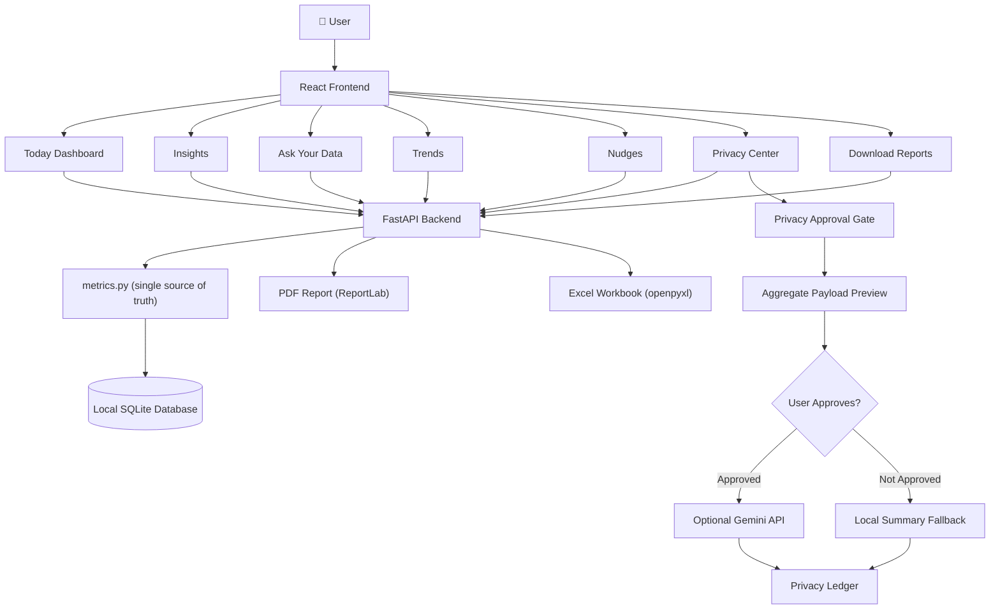
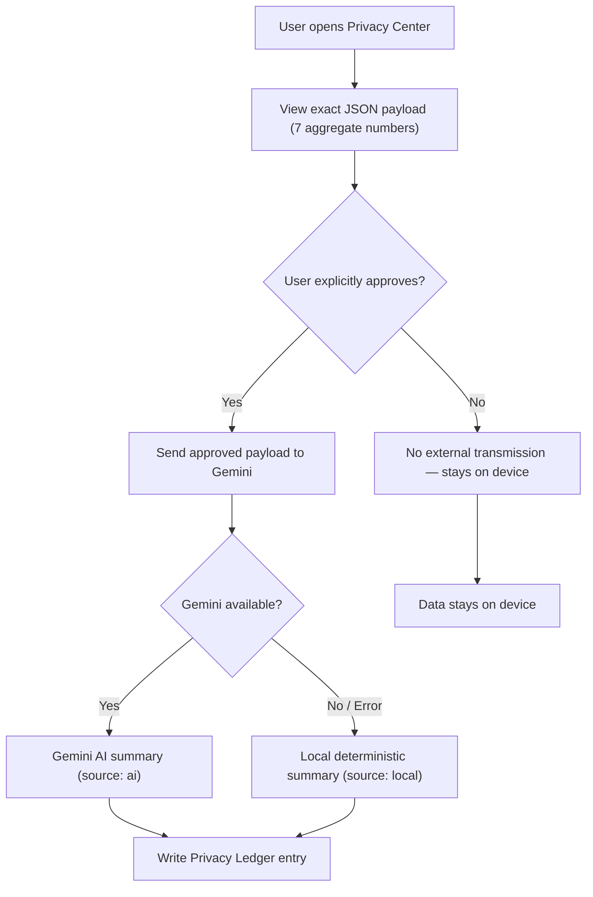
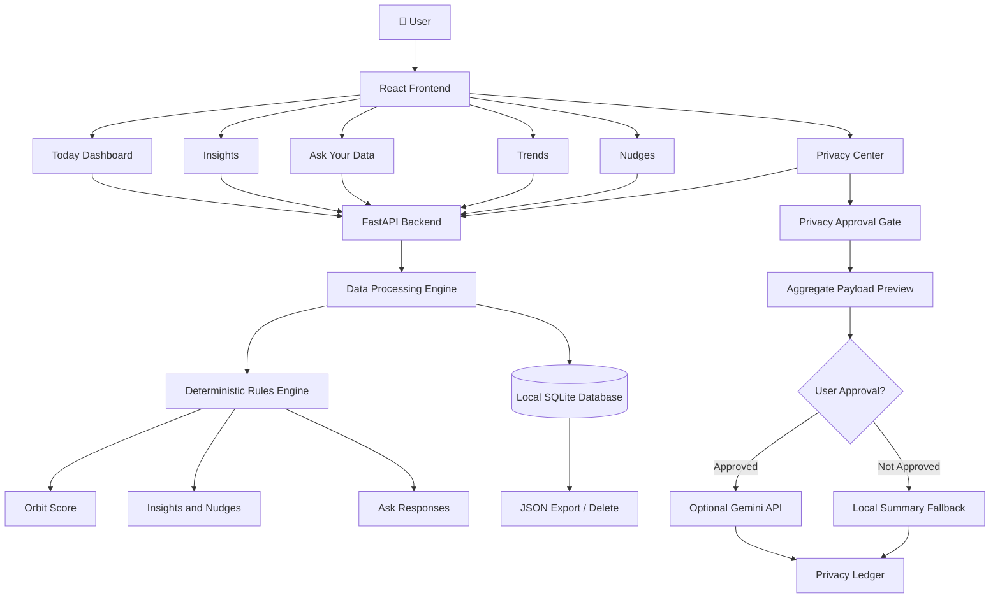
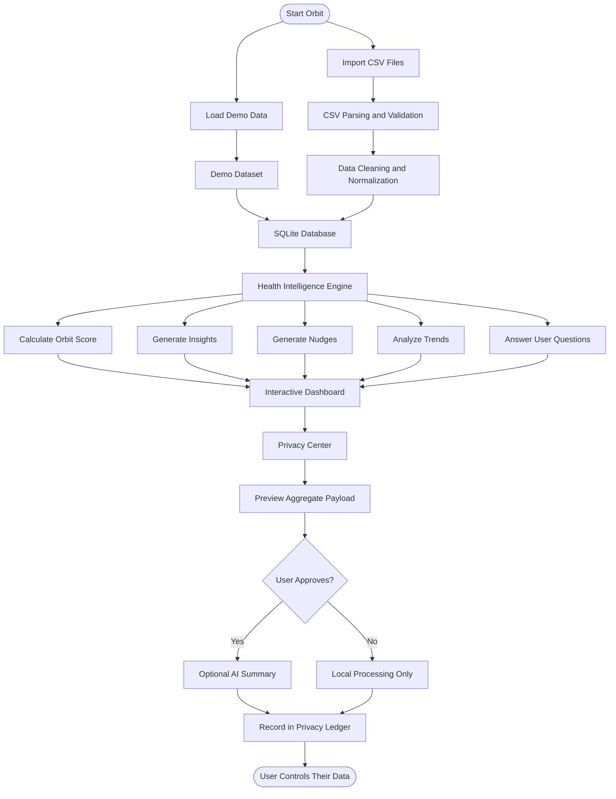
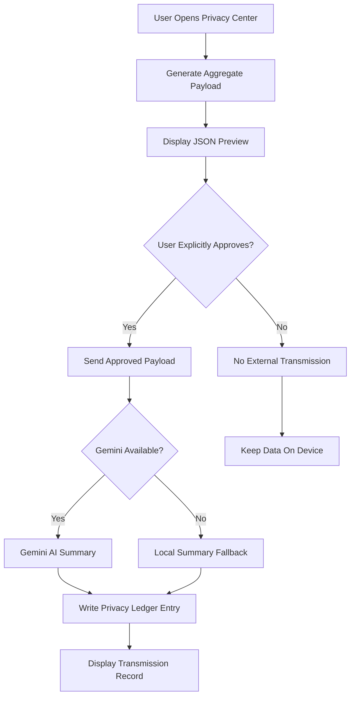
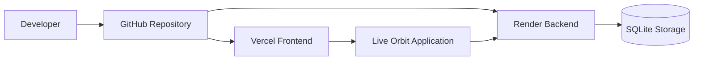

# 🪐 Orbit — Know Your **body**.

### Privacy you can see. Insights you can trust.

**A privacy-first personal health intelligence platform that transforms scattered health data into meaningful, explainable insights — all computed on your device.**

<p align="center">
  
  
  
  
  
  
  
</p>

---

## 🌌 Overview

Modern phones and watches collect enormous health data. It's scattered, unexplained, and silently shared with the cloud.

**Orbit solves this.** It merges your CSV exports from Apple Health, Garmin, Fitbit, or any wearable into one private, explainable health timeline — with an Orbit Score, natural-language Ask, downloadable PDF/Excel reports, and a Privacy Ledger recording every outbound event.

Metrics tracked:

| Metric | Colour |
|---|---|
| 👟 Steps | Teal `#0FA38F` |
| 🌙 Sleep duration | Indigo `#6C7BFF` |
| ❤️ Resting heart rate | Coral `#F2616B` |
| 😊 Mood (1–5) | Amber `#F5A524` |
| 💧 Water (litres) | Sky `#38A9F2` |

> **Orbit doesn't just tell you what your body is doing. It shows exactly what's computed, what leaves your device, and why.**

---

## ✨ Feature Overview (v3)

### 1. 🎯 Single Source of Truth — `metrics.py`
All numbers in the app are computed by **one canonical function**:

- **Anchor date** = latest date with recorded data (old datasets still work correctly)
- **Window A** = 7 calendar days ending at anchor; **Window B** = prior 7 days
- Averages skip missing days — a gap day is never treated as zero
- Insufficient data (< 3 valid days) shows "Not enough data" instead of a fake number
- Change is `(A − B) / B × 100`, rounded to a whole number; resting HR shows bpm diff
- Streak = consecutive days ending at anchor with steps ≥ goal (a gap breaks it)
- Short sleep nights = count of nights under 6 h in Window A
- **Orbit Score** (0–100) weighted: Steps 30 pts, Sleep 30 pts (−5% per short night), Heart 15 pts, Mood 15 pts, Consistency 10 pts

The Today hero, Stat cards, Insights, Nudges, Ask answers, Privacy payload, PDF and Excel all read from this one object. The frontend only formats numbers.

### 2. 📊 Bento Dashboard (Today)

- **Hero row**: Tagline + headline + band & streak chips + proof line ("Based on 7 days: …") | Score ring with Weights popover | 5 floating biomarker orbs
- **Stat cards**: Canonical average, change chip (semantic colour), progress bar labelled "x% of goal", "How is this calculated?" popover with window dates, prior average and formula
- **Charts**: 7-day chronological bar (steps) and area (sleep) charts — oldest to newest, left to right, dashed goal line
- **Proof line under hero**: "Based on 7 days: 19 to 25 Nov (7 of 7 days with data)"

### 3. 📄 Downloadable Reports (Phase 2)

Two real downloads saved directly to your Downloads folder:

| Format | Endpoint | Contents |
|---|---|---|
| **PDF (A4)** | `GET /api/report/pdf` | Cover, Orbit Score band, executive summary table, 14-day vector charts, explainable findings, proof table (Windows A & B marked), methodology, Privacy Ledger |
| **Excel (.xlsx)** | `GET /api/report/xlsx` | 5 sheets: Summary (live `AVERAGE` & change % formulas), Daily data, Insights, Privacy ledger, Method |

Both are served with `Content-Disposition: attachment` so your browser saves them directly. A "Raw data (JSON)" fallback link is available on the Privacy page.

### 4. 🧠 Explainable Insights

Grouped into Needs Attention / Going Well / Good to Know with a digest banner ("3 needs attention, 2 going well, 1 good to know"). Every card:
- Shows a consistent line icon, one sentence, and one key number with a change chip
- Has a collapsible "Why am I seeing this?" drawer with evidence numbers and rule text

### 5. 💬 Ask Your Data

Natural-language questions answered with canonical numbers and 3 follow-up suggestions. All on-device.

### 6. 🔔 Actionable Nudges

Time-anchored, concrete nudges ("Take a 10-minute walk at lunch") with Done, Snooze (3h / Tonight / Tomorrow) and voice read-aloud.

### 7. 🔐 Privacy Ledger

- Preview the exact JSON payload (7 aggregate numbers only — no raw records, no timestamps, no identifiers)
- One-time approval gate before anything touches Gemini
- Every approved event written to the on-device Privacy Ledger
- One-click Export (JSON) and Delete All

### 8. 📥 CSV Import with Full Report

After importing, the Settings page shows:

| Field | Description |
|---|---|
| Rows read | Total CSV rows parsed |
| Rows used | Rows that passed validation |
| Skipped | Count with expandable reasons |
| Date range | First → last date detected |
| Days in timeline | Total days after merge |

Supports Apple Health, Garmin, Fitbit, Google Fit, or any custom CSV. Auto-detects `DD/MM/YYYY` vs `YYYY-MM-DD`, converts sleep minutes to hours, merges duplicate dates, skips out-of-range values with recorded reasons.

### 9. 📱 Mobile-First Design

- 44 px tap targets on all interactive elements
- Bottom tab bar with "More" bottom sheet (Trends, Nudges, Settings + Download PDF/Excel)
- Zero horizontal overflow verified on 390 px viewport (iPhone 14 Pro)
- Charts at 200 px height on mobile
- Tables wrap as cards

### 10. 🛡️ No 502/504 Downtime

- 75-second fetch timeout with friendly waking screen (orbit animation + elapsed timer)
- Auto-retry polling every 4 s; manual retry after 90 s
- Keep-alive GitHub Action pings `/api/health` every 10 minutes (Render free tier)
- Early wake script pings the backend before React loads

---

## 🏗️ System Architecture



### Architecture Components

| Component | Responsibility |
|---|---|
| React 18 + Vite | UI, charts, theme, mobile |
| FastAPI | REST API, routing |
| `metrics.py` | **Single source of truth** for all numbers |
| `engine.py` | Insights, nudges, Ask, demo seeding |
| `reports.py` | PDF (ReportLab) and Excel (openpyxl) generation |
| SQLite | On-device health data storage |
| Pandas | CSV parsing and normalisation |
| Gemini API | Optional AI summary (approved payload only) |
| Privacy Ledger | Audit trail of approved outbound events |

---

## 🛠️ Technology Stack

### Frontend

| Technology | Version | Purpose |
|---|---|---|
| React | 18.3.1 | Component UI |
| Vite | 6.0.3 | Dev server and build |
| Recharts | 2.13.3 | Health charts |
| React Router | 6.28.0 | Navigation |
| Lucide React | 0.468.0 | Icons |
| Plain CSS + CSS variables | — | Design tokens, animations, themes |

No Tailwind. No Framer Motion. No other UI libraries.

### Backend

| Technology | Version | Purpose |
|---|---|---|
| Python | 3.11+ | Backend language |
| FastAPI | pinned | REST API framework |
| Uvicorn | pinned | ASGI server |
| SQLite3 | stdlib | On-device database |
| Pandas | pinned | CSV processing |
| ReportLab | pinned | PDF generation |
| openpyxl | pinned | Excel workbook |
| google-genai | pinned | Optional Gemini AI |
| Pytest | pinned | 59 automated tests |

### Optional AI

- Google Gemini only. Model: `gemini-2.5-flash` (override with `GEMINI_MODEL` env var)
- Called only from `POST /api/ai/summary` with the user-approved aggregate payload
- No key or any failure falls back to deterministic local summary with `"source":"local"`

---

## ⚡ Quick Start (Two Commands)

No API key needed. Demo data loads automatically on first run.

### 1. Backend

```bash
cd backend
pip install -r requirements.txt
uvicorn main:app --reload
```

Backend: `http://localhost:8000` · Swagger: `http://localhost:8000/docs`

### 2. Frontend

```bash
cd frontend
npm install
npm run dev
```

Frontend: `http://localhost:5173`

> On first start with an empty database, 30 days of realistic demo data are seeded automatically so the app is immediately useful.

---

## 🤖 Optional Gemini Configuration

```env
# backend/.env  (never commit this)
GEMINI_API_KEY=your_key_here
GEMINI_MODEL=gemini-2.5-flash   # optional override
CORS_ORIGINS=https://your-app.vercel.app   # production CORS
```

If the key is absent or the call fails, all features still work via the local deterministic fallback.

---

## 🧪 Testing

**59 automated backend tests**, all passing.

```bash
cd backend
python -m pytest
```

| Test file | Coverage |
|---|---|
| `test_engine.py` | 46 tests — CSV parsing, insights rules, Orbit Score, Ask, Privacy, records |
| `test_metrics.py` | 11 tests — 30-day set, gaps, duplicate dates, DD/MM/YYYY, sleep-in-minutes, historical dataset, goal changes, heart-rate bpm diff, cross-endpoint equality |
| `test_reports.py` | 2 tests — PDF and Excel download, valid content types, non-empty payload, live Excel formulas |

**Frontend build:**

```bash
cd frontend
npm run build   # ✓ 2031 modules transformed, 0 errors
```

---

## 📁 Project Structure

```text
orbit/
│
├── backend/
│   ├── main.py              # FastAPI app, CORS, lifespan auto-seed
│   ├── db.py                # SQLite helpers, anchor-date aware get_records()
│   ├── metrics.py           # ← Single source of truth for all numbers
│   ├── engine.py            # Insights, nudges, Ask, demo data
│   ├── reports.py           # PDF (ReportLab) + Excel (openpyxl) generation
│   ├── requirements.txt     # Pinned versions
│   │
│   ├── routers/
│   │   ├── health.py        # GET /api/health
│   │   ├── records.py       # GET /api/records
│   │   ├── demo.py          # POST /api/demo
│   │   ├── import_csv.py    # POST /api/import, GET /api/import/last-report
│   │   ├── insights.py      # GET /api/insights
│   │   ├── trends.py        # GET /api/trends
│   │   ├── ask.py           # POST /api/ask
│   │   ├── nudges.py        # GET/POST /api/nudges
│   │   ├── privacy.py       # GET /api/privacy/payload, POST /api/ai/summary
│   │   ├── data.py          # GET /api/export, DELETE /api/all, GET /api/ledger
│   │   ├── settings.py      # GET/PUT /api/settings
│   │   └── report.py        # GET /api/report/pdf, GET /api/report/xlsx
│   │
│   └── tests/
│       ├── test_engine.py
│       ├── test_metrics.py
│       └── test_reports.py
│
├── frontend/
│   ├── public/
│   ├── src/
│   │   ├── api/
│   │   │   └── client.js    # Fetch wrapper, timeout, BackendWakingError, downloadReportFile
│   │   ├── components/
│   │   │   ├── BubbleField.jsx
│   │   │   ├── BottomTabBar.jsx
│   │   │   ├── DeltaChip.jsx
│   │   │   ├── ErrorBoundary.jsx
│   │   │   ├── Header.jsx
│   │   │   ├── InsightCard.jsx
│   │   │   ├── OfflineBanner.jsx
│   │   │   ├── Sidebar.jsx
│   │   │   ├── SkeletonCard.jsx
│   │   │   ├── Tagline.jsx
│   │   │   ├── ToastContainer.jsx
│   │   │   └── WakingScreen.jsx
│   │   ├── context/
│   │   │   ├── AppContext.jsx
│   │   │   └── ToastContext.jsx
│   │   ├── hooks/
│   │   │   ├── useApi.js
│   │   │   ├── useTheme.js
│   │   │   └── useVoice.js
│   │   ├── pages/
│   │   │   ├── Ask.jsx
│   │   │   ├── Insights.jsx
│   │   │   ├── Nudges.jsx
│   │   │   ├── Privacy.jsx
│   │   │   ├── Settings.jsx
│   │   │   ├── Today.jsx
│   │   │   └── Trends.jsx
│   │   ├── styles/
│   │   │   ├── components.css  # All component / page styles
│   │   │   ├── globals.css     # Keyframes, base, sidebar, bottom tab bar
│   │   │   └── variables.css   # CSS custom properties, dark theme
│   │   ├── App.jsx
│   │   └── main.jsx
│   │
│   ├── index.html           # Early wake script, Inter font, page title
│   ├── package.json
│   ├── vite.config.js       # /api proxy to localhost:8000
│   └── vercel.json          # SPA rewrite + /api rewrite rules
│
├── sample/                  # Example CSV files for import
│   ├── mood_log.csv
│   ├── phone_steps.csv
│   ├── watch_sleep_hr.csv
│   └── water_log.csv
│
├── .github/
│   └── workflows/
│       └── keepalive.yml    # Pings /api/health every 10 min (Render free tier)
│
├── .env.example
├── .gitignore
└── README.md
```

---

## 🔐 Privacy Architecture

Privacy is not a setting. It is a visible process.

### The 7-Number Aggregate Payload

When users choose the optional AI summary, only this is sent to Gemini:

| Field | Description |
|---|---|
| `avg_steps` | 7-day average steps |
| `avg_sleep_hours` | 7-day average sleep |
| `avg_resting_hr` | 7-day average resting HR |
| `steps_change_pct` | Week-over-week % change |
| `short_sleep_nights` | Nights under 6 h in Window A |
| `goal_streak_days` | Consecutive goal achievement days |
| `orbit_score` | Current Orbit Score |

No raw records, no timestamps, no identifiers. Users preview the exact JSON before approving. Every approval is written to the on-device Privacy Ledger.

### Privacy Approval Flow



---

## 🚀 Deployment

### Vercel (Frontend)

1. Connect your GitHub repo to Vercel
2. Set build command: `cd frontend && npm install && npm run build`
3. Set output directory: `frontend/dist`
4. Add env var: `VITE_API_URL=https://your-render-backend.onrender.com/api`

The `frontend/vercel.json` includes SPA rewrites and `/api` proxy rules.

### Render (Backend)

1. Connect your GitHub repo to Render as a **Web Service**
2. Build command: `cd backend && pip install -r requirements.txt`
3. Start command: `cd backend && uvicorn main:app --host 0.0.0.0 --port $PORT`
4. Add env vars: `GEMINI_API_KEY`, `CORS_ORIGINS=https://your-app.vercel.app`

### Keep-Alive (Render Free Tier)

Render free-tier services sleep after 15 minutes of inactivity, causing a 502/503/504 on the first request.

Orbit handles this two ways:

1. **Frontend**: `WakingScreen` intercepts 502/503/504, shows a friendly animation, and polls `/api/health` every 4 s until the backend wakes (usually 20–30 s)
2. **GitHub Action** (`.github/workflows/keepalive.yml`): pings `$BACKEND_URL/api/health` every 10 minutes to keep the service warm

To enable the GitHub Action: add `BACKEND_URL` as a repository variable (not a secret) in your repo → Settings → Variables → Actions.

---

## 🧪 CSV Import Format

Orbit auto-detects column names from many wearable exports. Supported aliases:

| Metric | Accepted column names |
|---|---|
| Date | `date`, `Date`, `Day`, `timestamp` |
| Steps | `steps`, `Steps`, `step_count` |
| Sleep | `sleep`, `sleep_hours`, `sleep_duration` (auto-converts minutes to hours if >24) |
| Resting HR | `resting_hr`, `resting_heart_rate`, `heart_rate` |
| Mood | `mood`, `mood_score`, `mood_rating` (1–5 scale) |
| Water | `water`, `water_litres`, `water_l`, `water_ml` (auto-converts mL) |

**Validation ranges** (rows outside are skipped with a recorded reason):
- Steps: 0–100,000
- Sleep: 0–24 h
- Resting HR: 30–220 bpm
- Mood: 1–5
- Water: 0–10 L

**Date formats** auto-detected per file: `YYYY-MM-DD` and `DD/MM/YYYY`. Duplicate dates within a file are merged (last value wins per metric).

---

## ⚠️ Honest Product Limitations

1. **CSV import and demo data only.** No live Bluetooth or cloud wearable sync.
2. **Deterministic rule-based analysis.** Not machine-learning or medical diagnosis.
3. **Not medical advice.** Orbit is an informational personal wellness tool. Consult a qualified healthcare professional for medical concerns.
4. **Local SQLite storage.** Data is not backed up automatically. Use Export to save a JSON copy.

---

## 🔮 Future Roadmap

| Feature | Status |
|---|---|
| Android Health Connect live sync | Planned |
| Apple HealthKit CSV import helper | Planned |
| Encrypted device-to-device backup | Planned |
| Extended 90-day trend analysis | Planned |
| Adaptive nudge timing (circadian) | Planned |

---

## 💡 What Makes Orbit Different

| Traditional Health Apps | Orbit |
|---|---|
| Numbers without context | Canonical single-source numbers explained |
| Invisible AI data sharing | Preview exact payload before approving |
| No transmission history | On-device Privacy Ledger |
| Cloud-only analytics | All calculations run locally |
| Inconsistent numbers across screens | One `metrics.py` feeds every screen |
| No download | Audit-grade PDF + live-formula Excel |

---

## 🏆 Hackathon Info

**Event:** wHACKiest 2026  
**Track:** Track 3 — Know Thyself  
**Project:** Orbit — Know Your Body  
**Institution:** RIT Bengaluru

---

## 👥 Team

**Team Members:**

1. [Member Name] — [Role]
2. [Member Name] — [Role]
3. [Member Name] — [Role]
4. [Member Name] — [Role]

---

## 📜 Disclaimer

Orbit is intended for educational and personal wellness purposes only. It does not provide medical advice, diagnosis, treatment, or emergency healthcare services. Consult a qualified healthcare professional for medical concerns.

---

<p align="center">

### 🪐 Orbit — Know Your **body**.

**Privacy you can see. Insights you can trust.**

Made with ❤️ for wHACKiest 2026.

</p>

---

demo mvp link - https://orbit-one-ashy.vercel.app/

## 🌌 Overview

Modern smartphones, smartwatches, and fitness trackers collect enormous amounts of personal health data. However, this information is scattered across different applications, making it difficult for individuals to understand their health patterns.

Most applications display numbers without explaining what they mean, while cloud-based AI solutions often require users to share sensitive personal information.

**Orbit solves this problem.**

Orbit is a privacy-first personal health intelligence application that brings together:

- 👟 Daily steps
- 🌙 Sleep duration
- ❤️ Resting heart rate
- 😊 Mood tracking
- 💧 Water intake

It transforms these metrics into a unified health timeline, computes an explainable Orbit Score, identifies cross-metric patterns, generates actionable nudges, and allows users to interact with their own data through natural language.

Its defining feature is **Privacy You Can See**: users can preview the exact aggregate information before approving an optional AI request.

> **Orbit doesn't just tell you what your body is doing. It helps you understand why, what you can try next, and what happens to your data.**

---

## ✨ Key Features

### 1. 🪐 Orbit Score — Your Health at a Glance

A unified score ranging from 0–100 that combines five health and lifestyle indicators.

- Steps
- Sleep
- Resting heart rate
- Mood
- Consistency

The central Orbit visualization displays five interactive biomarker orbs, with their sizes adapting to goal progress.

### 2. 📊 Interactive Health Dashboard

A visually rich dashboard featuring:

- Animated metric cards.
- Daily goal completion indicators.
- Weekly performance comparisons.
- Interactive sparklines.
- Seven-day steps visualization.
- Seven-day sleep duration chart.
- Responsive light and dark themes.

### 3. 🧠 Explainable Insights

Orbit identifies relationships between different health metrics using deterministic rules.

Example:

**Short sleep and next-day activity**

Orbit can identify whether days following shorter sleep periods are associated with lower step counts.

Every insight includes a **"Why am I seeing this?"** explanation with the underlying numbers and mathematical rule.

### 4. 💬 Ask Your Data

A conversational interface that allows users to ask questions about their own health information.

Example questions:

- Why am I feeling tired?
- How many steps did I take?
- What is my average sleep duration?
- How is my resting heart rate changing?
- Am I meeting my daily goals?

Answers are generated using locally available data, with supporting evidence and suggested follow-up questions.

### 5. 🔔 Actionable Nudges

Orbit generates proactive, personalized suggestions based on recorded health patterns.

Examples:

- Take a short walk to reach your step goal.
- Try going to bed earlier after shorter sleep nights.
- Remember to maintain your hydration habits.
- Consider taking time to recover when resting heart rate rises.

Users can:

- Mark suggestions as Done.
- Snooze reminders.
- Choose snooze presets.
- Listen to suggestions using text-to-speech.
- Receive desktop notifications.

### 6. 📈 Cross-Metric Trends

Explore relationships between health indicators using interactive charts.

- Compare any two metrics.
- Choose 7, 14, or 30-day periods.
- View changes across multiple health indicators.
- Understand patterns through visual comparisons.

### 7. 🔐 Privacy Ledger — Our Core Innovation

**Privacy is not just a setting in Orbit. It is a visible process.**

Orbit follows a privacy-first approach:

- Health calculations run locally using SQLite.
- No raw health records are included in the optional AI payload.
- Only seven anonymized aggregate values are prepared.
- Users can preview the exact JSON payload.
- Nothing is transmitted to Gemini without explicit one-time approval.
- Outbound events and approvals are recorded in a local Privacy Ledger.
- Users can export their information as JSON.
- Users can permanently delete their stored data.

---

## 🏗️ System Architecture

Orbit uses a modular frontend-backend architecture.



### Architecture Components

| Component | Responsibility |
|---|---|
| React + Vite | User interface and visualization |
| FastAPI | Backend API and application logic |
| SQLite | Local health data storage |
| Pandas | CSV processing and normalization |
| Rules Engine | Scores, insights, nudges and answers |
| Gemini API | Optional AI-generated summaries |
| Privacy Ledger | Records approved outbound events |

---

## 🔄 How Orbit Works — End-to-End Workflow



---

## 🔐 Privacy Architecture

Privacy is the central design principle of Orbit.

### The Seven-Number Aggregate Payload

When users choose to generate an optional AI summary, Orbit prepares an aggregate payload containing:

| Field | Description |
|---|---|
| `avg_steps` | Average daily steps |
| `avg_sleep_hours` | Average sleep duration |
| `avg_resting_hr` | Average resting heart rate |
| `steps_change_pct` | Percentage change in steps |
| `short_sleep_nights` | Count of short-sleep nights |
| `goal_streak_days` | Consecutive goal achievement days |
| `orbit_score` | Overall Orbit Score |

### Privacy Approval Workflow



**Privacy guarantees and design goals:**

- No raw health records in the optional AI payload.
- No timestamps in the seven-number aggregate payload.
- No personal identifiers in that payload.
- No automatic AI transmission.
- Explicit approval before each outbound request.
- Local export and deletion controls.

---

## 🛠️ Technology Stack

### Frontend

| Technology | Purpose |
|---|---|
| React 18 | Component-based UI |
| Vite | Development server and build |
| Recharts | Health charts and visualizations |
| React Router | Application navigation |
| Lucide React | Interface icons |
| CSS | Design tokens, animations and themes |

### Backend

| Technology | Purpose |
|---|---|
| Python 3.11+ | Core backend language |
| FastAPI | REST API framework |
| SQLite3 | Database |
| Pandas | Data processing |
| Pydantic | Data validation |
| Uvicorn | ASGI server |
| Pytest | Automated testing |

### Optional AI Integration

- Google Gemini API
- Model: `gemini-2.5-flash`
- Optional `GEMINI_API_KEY`
- Deterministic local fallback when Gemini is unavailable.

### Deployment

- Frontend: Vercel
- Backend: Render
- Source control: GitHub

---

## 📁 Project Structure

```text
Orbit/
│
├── backend/
│   ├── main.py
│   ├── db.py
│   ├── engine.py
│   ├── requirements.txt
│   │
│   ├── routers/
│   │
│   └── tests/
│       └── ...
│
├── frontend/
│   ├── public/
│   ├── src/
│   │   ├── components/
│   │   ├── context/
│   │   ├── hooks/
│   │   ├── pages/
│   │   │   ├── Ask.jsx
│   │   │   ├── Insights.jsx
│   │   │   ├── Nudges.jsx
│   │   │   ├── Privacy.jsx
│   │   │   ├── Settings.jsx
│   │   │   ├── Today.jsx
│   │   │   └── Trends.jsx
│   │   │
│   │   ├── styles/
│   │   ├── App.jsx
│   │   └── main.jsx
│   │
│   ├── package.json
│   └── vite.config.js
│
├── sample/
│   ├── mood_log.csv
│   ├── phone_steps.csv
│   ├── watch_sleep_hr.csv
│   └── water_log.csv
│
├── scripts/
│   ├── smoke.ps1
│   ├── smoke.sh
│   └── test_browser.js
│
├── screenshots/
│
├── .env.example
├── .gitignore
└── README.md
```

---

## ⚡ Installation and Quick Start

Orbit can run locally without any API keys.

### Prerequisites

Install the following:

- Python 3.11 or later
- Node.js and npm
- Git

### 1. Clone the Repository

```bash
git clone https://github.com/dishanth24/Orbit.git
cd Orbit
```

### 2. Start the Backend

Open a terminal:

```bash
cd backend
```

Install Python dependencies:

```bash
pip install -r requirements.txt
```

Start FastAPI:

```bash
uvicorn main:app --reload
```

Backend URL:

```text
http://localhost:8000
```

API documentation:

```text
http://localhost:8000/docs
```

### 3. Start the Frontend

Open another terminal:

```bash
cd frontend
```

Install dependencies:

```bash
npm install
```

Start Vite:

```bash
npm run dev
```

Frontend URL:

```text
http://localhost:5173
```

**That's it!** Orbit is ready to use.

---

## 🤖 Optional Gemini Configuration

Orbit does not require an API key to operate.

To enable optional Gemini-powered summaries:

1. Obtain a Gemini API key.
2. Configure the backend environment variable.
3. Restart the backend.

Example `.env` configuration:

```env
GEMINI_API_KEY=your_gemini_api_key_here
```

Keep your API key private. Never commit your `.env` file to GitHub.

If the key is unavailable or the Gemini request fails, Orbit uses its local deterministic summary fallback.

---

## 🧪 Testing and Quality Assurance

Orbit includes **46 automated backend tests** covering important application functionality.

### Run Backend Tests

```bash
cd backend
python -m pytest tests/ -v
```

### Run Windows Smoke Tests

From the project root:

```powershell
.\scripts\smoke.ps1
```

### Run Linux / macOS Smoke Tests

```bash
./scripts/smoke.sh
```

### Build Frontend

```bash
cd frontend
npm run build
```

### Areas Covered

- CSV parsing and validation.
- Column alias normalization.
- BOM stripping.
- Sleep duration conversion.
- Date format handling.
- Insight generation rules.
- Orbit Score boundaries.
- Privacy payload verification.

---

## 🖥️ Application Screenshots

Screenshots of Orbit's major features can be added here.

Create screenshots in the `screenshots/` directory and update the image paths below.

### Today — Orbit Dashboard


### Insights — Understand Your Patterns


### Ask Your Data — Conversational Intelligence


### Trends — Cross-Metric Analysis


### Nudges — Actionable Recommendations


### Privacy — Transparency and Control


---

## 🚀 Deployment

Orbit uses a separated frontend and backend deployment architecture.

| Layer | Platform |
|---|---|
| Frontend | Vercel |
| Backend | Render |
| Source Code | GitHub |

### Deployment Flow



GitHub commits trigger deployments automatically when auto-deploy is enabled and the corresponding deployment configuration is correct.

---

## 💡 What Makes Orbit Different?

| Traditional Health Apps | Orbit |
|---|---|
| Scattered health information | Unified health timeline |
| Numbers without explanations | Explainable insights |
| Generic reminders | Personalized nudges |
| Limited cross-metric analysis | Cross-metric trends |
| Invisible AI data sharing | Visible payload preview |
| No clear transmission history | Privacy Ledger |
| Dependence on cloud AI | Deterministic local fallback |

### Our Core Innovation

**Deterministic First. AI Optional. Privacy Always.**

Orbit is designed to provide useful health intelligence without requiring a cloud AI service.

---

## ⚠️ Honest Product Limitations

Orbit is currently a working prototype with the following limitations:

1. **CSV Import:** Supports CSV imports and preloaded realistic demo data. Live background Bluetooth synchronization with wearables is not currently available.
2. **Rule-Based Intelligence:** Core insights and scores are deterministic and based on mathematical rules, not medical diagnosis.
3. **Optional AI:** Gemini is used only for the explicitly approved aggregate summary workflow.
4. **Not Medical Advice:** Orbit is an educational personal health intelligence application, not a medical diagnostic device.

---

## 🔮 Future Roadmap

| Feature | Planned Enhancement |
|---|---|
| Health Integration | Android Health Connect |
| Apple Integration | Apple Health export import |
| Wearable Sync | Live device synchronization |
| AI Intelligence | Smarter on-device insights |
| Personalization | Custom goals and recommendations |
| Notifications | Improved adaptive reminders |
| Backup | Encrypted device-to-device backup |
| Analytics | Extended health history and reporting |

---

## 🎯 Target Users

Orbit is designed for:

- 🎓 Students interested in understanding their daily health habits.
- 💼 Working professionals managing busy routines.
- 🏃 Fitness enthusiasts tracking their activity and recovery.
- ⌚ Smartwatch users who want meaningful health insights.
- 🔐 Privacy-conscious individuals who want control over their personal information.

---

## 🏆 Hackathon Project

**Event:** wHACKiest 2026  
**Track:** Track 3 — Know Thyself  
**Project:** Orbit — Know Your Body  
**Category:** Privacy-First Personal Health Intelligence

### Our Vision

We believe personal health data should empower individuals, not compromise their privacy.

Orbit aims to make personal health intelligence understandable, actionable, and transparent.

> **Your data. Your insights. Your control.**

---

## 👥 Team

**Team Name:** [Your Team Name]

**Team Members:**

1. [Member Name] — [Role]
2. [Member Name] — [Role]
3. [Member Name] — [Role]
4. [Member Name] — [Role]

**Institution:** RIT Bengaluru

---

## 📜 Disclaimer

Orbit is intended for educational and personal wellness purposes only. It does not provide medical advice, diagnosis, treatment, or emergency healthcare services. Users should consult qualified healthcare professionals for medical concerns.

---

<p align="center">

### 🪐 Orbit — Know Your Body.

**Privacy you can see. Insights you can trust.**

Made with ❤️ for wHACKiest 2026.

</p>
